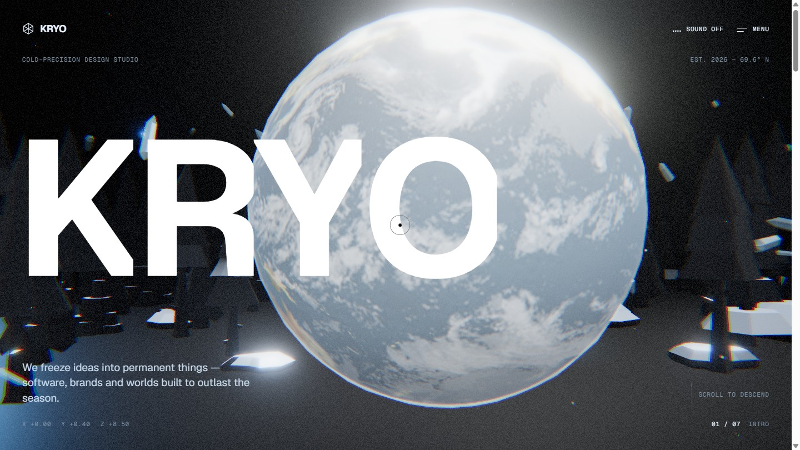
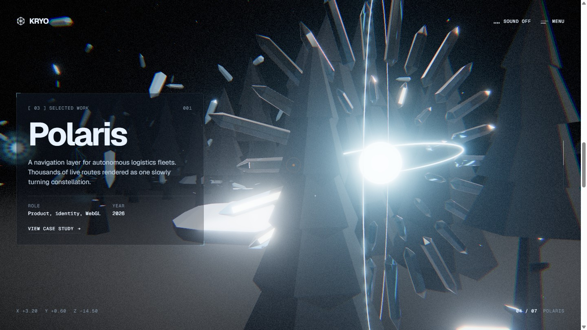
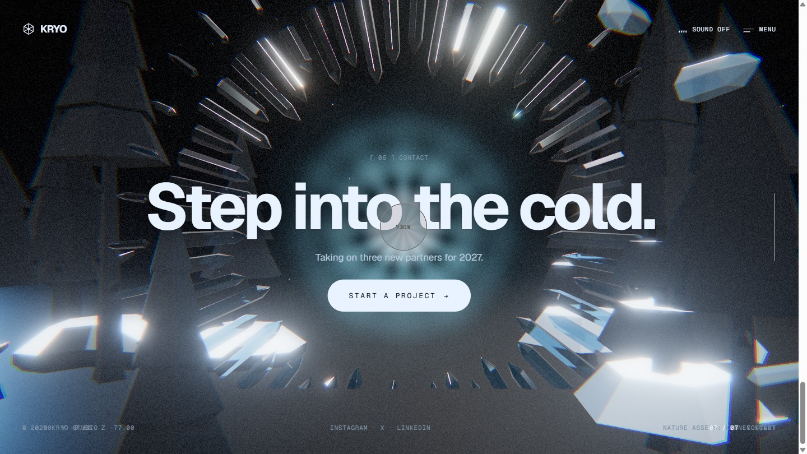

<div align="center">

# KRYO — Cinematic 3D Landing Page

**A scroll-driven WebGL experience: one continuous 3D world the camera flies through as you scroll.**

[**Live demo →**](https://stato10.github.io/kryo-landing/)



</div>

## Highlights

- **One continuous 3D world.** Scrolling moves the camera along a spline through seven stations: intro, manifesto, capabilities, three case studies and a crystal-portal finale.
- **Models built in Blender.** Crystals, the ice monolith, the wire geode and the portal were generated procedurally in Blender (scripted through its Python API), exported as Draco-compressed glTF (525 KB), then merged per group at runtime to keep draw calls low.
- **Frozen forest.** Low-poly pines and rocks from the Kenney Nature Kit (CC0), re-shaded in the page with a custom snow shader: dark bark and foliage, with snow on every upward-facing face.
- **Physically based ice.** `MeshPhysicalMaterial` transmission, IOR, attenuation and iridescence, lit by a PMREM room environment.
- **Post-processing.** MSAA, bloom, and a custom pass for chromatic aberration (driven by scroll speed), vignette and film grain.
- **Interface details.** Text scramble reveals, a word-by-word manifesto, count-up stats, a full-screen menu, a magnetic cursor with 3D hover states, and a live camera-coordinate HUD.
- **Generative sound.** An ambient drone, wind and UI chimes synthesised with the Web Audio API, with no audio files.
- **Built to run.** Capped pixel ratio, instanced rendering, shaders precompiled behind the loader, camera damping on real time so it never lags behind the scroll, and lighter settings on touch devices.

| Polaris | Finale |
|---|---|
|  |  |

## Stack

three.js r187 · GLSL · GSAP + ScrollTrigger · Lenis · Blender 5.2 (Python API) · glTF/Draco · Web Audio API. It's a single HTML file with no build step.

## Run locally

The models load over HTTP, so serve the folder rather than opening the file directly:

```bash
python -m http.server 5173
```

Then open http://localhost:5173.

## Project structure

```
index.html                 the whole page: markup, styles and the three.js scene
models/kryo.glb            Blender-built crystals, monolith, geode and portal (Draco)
models/nature.glb          Kenney Nature Kit pines and rocks (Draco)
blender/kryo_models.blend  editable source scenes for both GLBs
docs/                      screenshots
```

## Credits

- Nature models: [Kenney Nature Kit](https://kenney.nl/assets/nature-kit) (CC0).
- KRYO is a fictional studio. All copy and project names are placeholders.
